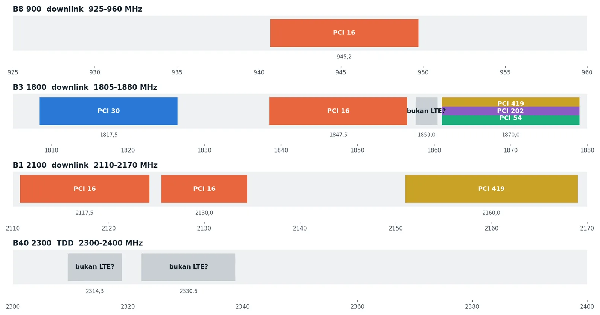
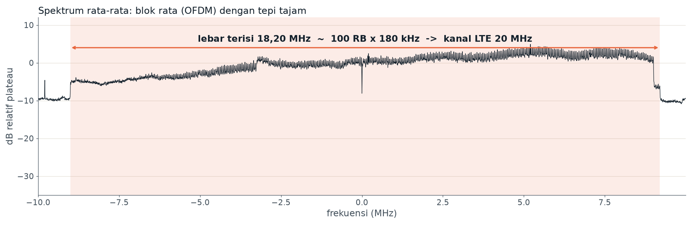
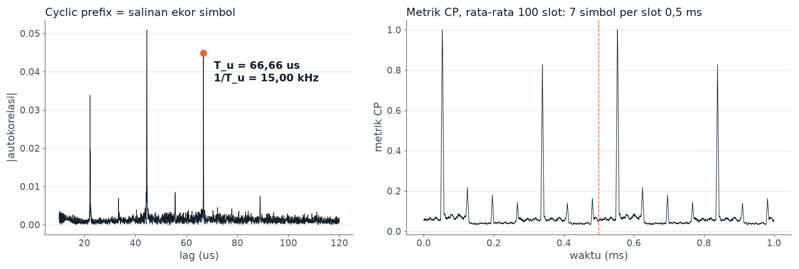
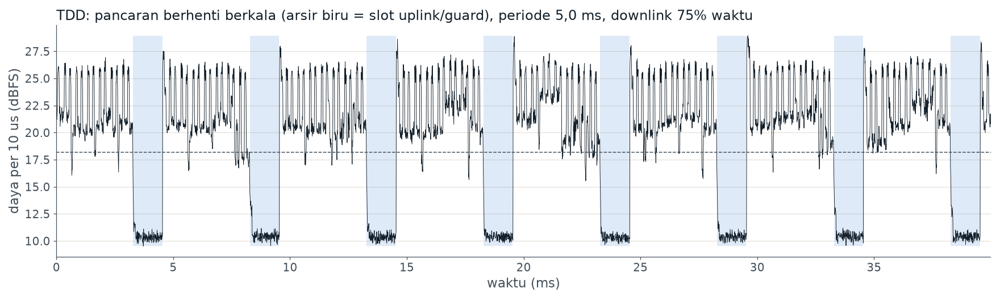
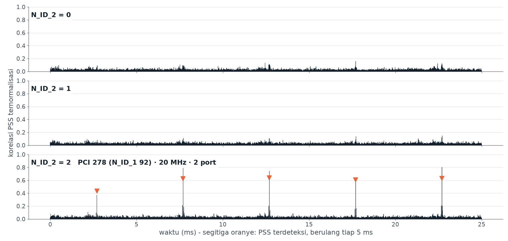
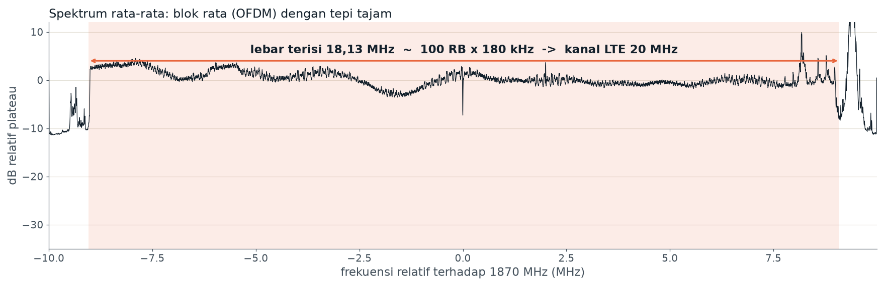
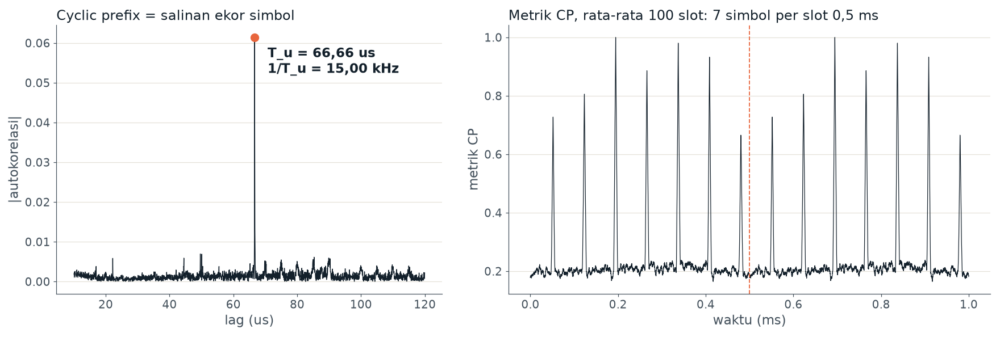
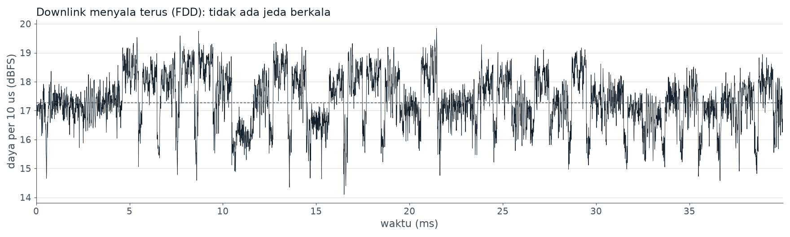
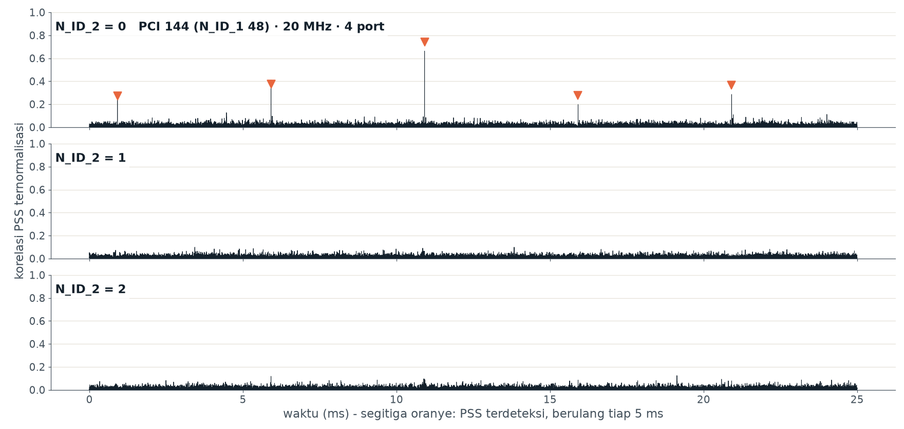
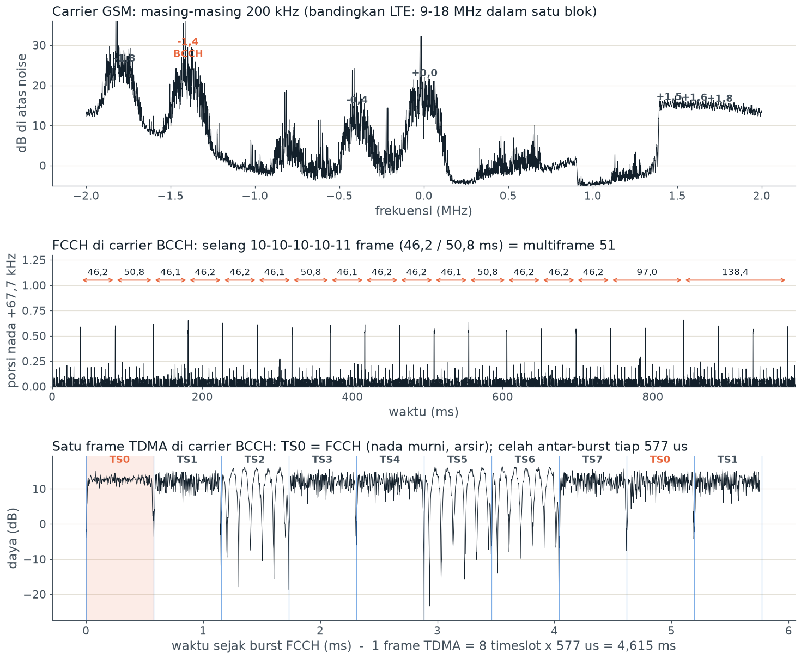

# Laporan Penugasan Mandiri: Investigasi Detektif Seluler
## Analisis Forensik Sinyal Radio, Estimasi Topologi Tower, dan Evaluasi Kapasitas Puncak Operator (Kasus 1 – 3)

**Mata Kuliah:** CIF65217 Jaringan Nirkabel  
**Topik:** Bab 5 Wireless WAN: Detektif Seluler (Take-Home Kasus 1–3)  
**Nama Mahasiswa:** Edgar Jason Husin  
**NIM:** 245150201111047  
**Alat & Instrumen:** Software-Defined Radio (HackRF One), Analisis DSP Python, Rekaman IQ (In-phase/Quadrature), dan Aplikasi Pengukuran Ponsel (NetMonster / Network Cell Info Lite)  

---

## Pernyataan Etika & Batasan Hukum Investigasi
Laporan ini disusun dengan kepatuhan penuh terhadap prinsip etika rekayasa telekomunikasi dan hukum perundang-undangan Republik Indonesia:
1. **Objek Investigasi Bersifat Terbuka:** Seluruh analisis sinyal radio pasif hanya berfokus pada **infrastruktur fisik publik (BTS/eNodeB, carrier spektrum, dan operator seluler)** yang dipancarkan secara terbuka (*unencrypted broadcast channels*: PSS, SSS, PBCH/MIB) agar perangkat ponsel dapat mendeteksi jaringan.
2. **Perlindungan Data Pribadi & Privasi:** Tidak dilakukan perekaman, intersepsi, maupun analisis terhadap *traffic* data pengguna (*uplink bursts* milik pengguna lain). Investigasi ini patuh terhadap **UU No. 36 Tahun 1999 tentang Telekomunikasi (Pasal 40 tentang larangan penyadapan)** dan **UU No. 27 Tahun 2022 tentang Pelindungan Data Pribadi (UU PDP)**.
3. **Titik Pengukuran Lapangan:** Pengujian verifikasi ponsel lapangan dilakukan secara eksklusif di **fasilitas umum lingkungan kampus**, sehingga tidak mengungkapkan informasi lokasi privat seseorang.

---

## Daftar Isi
1. [Kasus 1: Di Mana Tower-nya? (Investigasi Lokasi & Topologi Site)](#kasus-1-di-mana-tower-nya-investigasi-lokasi--topologi-site)
   - 1.1 [Tabel Bukti Inventaris Sel Titik Ukur A](#11-tabel-bukti-inventaris-sel-titik-ukur-a)
   - 1.2 [Bagian A: Penalaran & Analisis Data SDR Titik Ukur A](#12-bagian-a-penalaran--analisis-data-sdr-titik-ukur-a)
   - 1.3 [Bagian B: Pengukuran Lapangan Ponsel di 3 Titik Kampus](#13-bagian-b-pengukuran-lapangan-ponsel-di-3-titik-kampus)
   - 1.4 [Rekonstruksi Peta Kampus & Topologi Arah Sektor Tower](#14-rekonstruksi-peta-kampus--topologi-arah-sektor-tower)
2. [Kasus 2: Sinyal Misterius (Laporan Forensik 5 Rekaman IQ)](#kasus-2-sinyal-misterius-laporan-forensik-5-rekaman-iq)
   - 2.1 [Metodologi Sidik Jari Sinyal Radio](#21-metodologi-sidik-jari-sinyal-radio)
   - 2.2 [Laporan Forensik Rekaman 1 (misteri_1.cs8)](#22-laporan-forensik-rekaman-1-misteri_1cs8)
   - 2.3 [Laporan Forensik Rekaman 2 (misteri_2.cs8)](#23-laporan-forensik-rekaman-2-misteri_2cs8)
   - 2.4 [Laporan Forensik Rekaman 3 (misteri_3.cs8)](#24-laporan-forensik-rekaman-3-misteri_3cs8)
   - 2.5 [Laporan Forensik Rekaman 4 (misteri_4.cs8)](#25-laporan-forensik-rekaman-4-misteri_4cs8)
   - 2.6 [Laporan Forensik Rekaman 5 (misteri_5.cs8)](#26-laporan-forensik-rekaman-5-misteri_5cs8)
   - 2.7 [Matriks Rekapitulasi Sinyal & Validasi Pita Frekuensi 3GPP](#27-matriks-rekapitulasi-sinyal--validasi-pita-frekuensi-3gpp)
3. [Kasus 3: Operator Mana yang Paling Siap? (Kapasitas Puncak & Kesiapan Jaringan)](#kasus-3-operator-mana-yang-paling-siap-kapasitas-puncak--kesiapan-jaringan)
   - 3.1 [Identifikasi Kepemilikan Spektrum Operator di Titik A](#31-identifikasi-kepemilikan-spektrum-operator-di-titik-a)
   - 3.2 [Formulasi Matematis & Perhitungan Kapasitas Puncak Teoretis](#32-formulasi-matematis--perhitungan-kapasitas-puncak-teoretis)
   - 3.3 [Analisis Kesenjangan: Kapasitas Teoretis vs Throughput Riil Speedtest](#33-analisis-kesenjangan-kapasitas-teoretis-vs-throughput-riil-speedtest)
   - 3.4 [Rekomendasi Objektif Kebutuhan Akses Internet Kampus](#34-rekomendasi-objektif-kebutuhan-akses-internet-kampus)
4. [Pengantar Diskusi Kelas: Analisis Empat Pertanyaan Inti](#pengantar-diskusi-kelas-analisis-empat-pertanyaan-inti)

---

## Kasus 1: Di Mana Tower-nya? (Investigasi Lokasi & Topologi Site)

### 1.1 Tabel Bukti Inventaris Sel Titik Ukur A
Berdasarkan perekaman sapuan frekuensi SDR HackRF One di Titik Ukur A, terdeteksi 9 carrier sel LTE yang berhasil diekstraksi parameter lapisan fisiknya (melalui deteksi PSS/SSS dan *decoding* PBCH MIB).

| No | Pita Frekuensi | Frekuensi Tengah ($f_c$) | EARFCN | PCI | MIB Bandwidth | Konfigurasi Port Antena | Basis Waktu ("Jam") |
|:---:|:---:|:---:|:---:|:---:|:---:|:---:|:---:|
| 1 | **B8 (900 MHz)** | 945,2 MHz | 3652 | **16** | 10 MHz ($N_{\text{RB}} = 50$) | 2 Port | **Jam A** (GPS) |
| 2 | **B3 (1800 MHz)** | 1817,5 MHz | 1325 | **30** | 20 MHz ($N_{\text{RB}} = 100$) | 4 Port | **Jam A** (GPS) |
| 3 | **B3 (1800 MHz)** | 1847,5 MHz | 1625 | **16** | 20 MHz ($N_{\text{RB}} = 100$) | 4 Port | **Jam A** (GPS) |
| 4 | **B3 (1800 MHz)** | 1870,0 MHz | 1850 | **202** | 20 MHz ($N_{\text{RB}} = 100$) | 2 Port | **Jam B** (Offset) |
| 5 | **B3 (1800 MHz)** | 1870,0 MHz | 1850 | **419** | 20 MHz ($N_{\text{RB}} = 100$) | 2 Port | **Jam B** (Offset) |
| 6 | **B3 (1800 MHz)** | 1870,0 MHz | 1850 | **54** | 20 MHz ($N_{\text{RB}} = 100$) | 2 Port | **Jam A** (GPS) |
| 7 | **B1 (2100 MHz)** | 2117,5 MHz | 75 | **16** | 15 MHz ($N_{\text{RB}} = 75$) | 4 Port | **Jam A** (GPS) |
| 8 | **B1 (2100 MHz)** | 2130,0 MHz | 200 | **16** | 10 MHz ($N_{\text{RB}} = 50$) | 4 Port | **Jam A** (GPS) |
| 9 | **B1 (2100 MHz)** | 2160,0 MHz | 500 | **419** | 20 MHz ($N_{\text{RB}} = 100$) | 2 Port | **Jam B** (Offset) |



> **Keterangan Acuan Basis Waktu ("Jam"):**
> - **Jam A:** Sinyal memiliki fase *System Frame Number* (SFN) yang tersinkronisasi presisi dengan sinyal acuan waktu satelit GPS (selisih waktu rambat $\approx 0\text{ ms}$).
> - **Jam B:** Sinyal memiliki offset fase SFN mandiri (*free-running local clock* atau offset jaringan backhaul IP PTP), tidak sinkron dengan waktu GPS.

---

### 1.2 Bagian A: Penalaran & Analisis Data SDR Titik Ukur A

#### Pertanyaan 1: PCI 16 Muncul di 4 Carrier (900, 1800, 2100 MHz) dengan Jam yang Sama
- **Makna bagi Jumlah Site:**  
  Kemunculan PCI 16 secara simultan pada 4 frekuensi pembawa yang berbeda—yaitu 945,2 MHz (B8), 1847,5 MHz (B3), 2117,5 MHz (B1), dan 2130,0 MHz (B1)—dengan basis waktu yang persis identik (**Jam A**) membuktikan bahwa seluruh carrier tersebut dipancarkan dari **SATU site / tower fisik yang sama**, secara spesifik dari **satu sektor fisik antena eNodeB yang sama**.
- **Alasan Operator Menggunakan PCI yang Sama di Beberapa Carrier:**  
  Dalam arsitektur LTE-Advanced (LTE-A), operator menerapkan teknologi **Carrier Aggregation (CA)** antarpita (*Inter-band CA*) dan dalam pita (*Intra-band non-contiguous CA*). Operator sengaja mengonfigurasikan *Physical Cell ID* (PCI) yang seragam pada satu arah sektor fisik untuk:
  1. **Menyederhanakan Manajemen Sumber Daya Radio (RRM):** Perangkat ponsel (*User Equipment* / UE) dapat mengunci satu sel primer (*Primary Cell* / PCell) dan secara transparan mengaktifkan sel sekunder (*Secondary Cell* / SCell) dari antena fisik yang sama tanpa harus melakukan kalkulasi ulang orientasi arah propagasi.
  2. **Efisiensi Prosedur Handover:** Mengurangi overhead persinyalan antarsel ketika ponsel berpindah sektor, karena koordinasi multi-carrier berada di bawah penjadwal (*scheduler*) baseband fisik yang identik.

---

#### Pertanyaan 2: Keberadaan PCI 54, 202, dan 419 di Carrier 1870 MHz dalam Satu Rekaman
- **Sel yang PASTI Berasal dari eNodeB Berbeda:**  
  **PCI 54 dipastikan 100% berasal dari eNodeB yang berbeda secara fisik dengan PCI 202 dan PCI 419.**
- **Bukti Teknis yang Digunakan:**  
  Bukti mutlaknya terletak pada **perbedaan domain waktu dan fase jam (SFN Phase / Radio Frame Boundary)**:
  - PCI 54 beroperasi di bawah acuan **Jam A** (tersinkronisasi penuh dengan GPS).
  - PCI 202 dan PCI 419 beroperasi di bawah acuan **Jam B** (memiliki offset waktu lokal mandiri).
  - Satu unit perangkat keras baseband eNodeB (*Baseband Unit* / BBU) secara fisik tidak mungkin memancarkan dua frame radio LTE dengan basis referensi clock yang saling terpisah ratusan milidetik. Perbedaan jam ini menjadi bukti fisik yang tidak terbantahkan bahwa pemancar PCI 54 berada pada unit BTS/tower yang berbeda lokasi dan perangkatnya dari pemancar PCI 202/419.

---

#### Pertanyaan 3: Evaluasi PCI 202 dan 419 (Timing & SFN Sama, $N_{\text{ID}}^{(1)}$ Berbeda)
- **Dekomposisi Identitas Fisik Sel:**  
  Rumus standar penentuan PCI menurut 3GPP TS 36.211 adalah:
  
  $$\text{PCI} = 3 \times N_{\text{ID}}^{(1)} + N_{\text{ID}}^{(2)}$$
  
  - Untuk PCI 202: $202 = 3 \times 67 + 1 \implies N_{\text{ID}}^{(1)} = 67,\, N_{\text{ID}}^{(2)} = 1$
  - Untuk PCI 419: $419 = 3 \times 139 + 2 \implies N_{\text{ID}}^{(1)} = 139,\, N_{\text{ID}}^{(2)} = 2$
- **Analisis Jumlah Site:**  
  Meskipun kedua sel berbagi timing frame dan nomor SFN yang sama (Jam B), keduanya **berasal dari DUA site fisik yang berbeda (atau dua tower yang terpisah secara geografis)**.
- **Rantai Bukti & Derajat Keyakinan:**  
  - *Tingkat Keyakinan:* **Sedang–Tinggi (Moderate-to-High)**.
  - *Alasan Teknis:* Pada penomoran sel standar operator, tiga sektor dalam satu site/tower fisik yang sama hampir selalu menggunakan grup SSS ($N_{\text{ID}}^{(1)}$) yang sama dengan memvariasikan indeks PSS ($N_{\text{ID}}^{(2)} \in \{0, 1, 2\}$), misalnya konfigurasi PCI berurutan $3k, 3k+1, 3k+2$. Perbedaan grup SSS yang melonjak drastis ($N_{\text{ID}}^{(1)} = 67$ vs $139$) menandakan alokasi cluster perencanaan frekuensi dari site yang berbeda.
  - Selain itu, PCI 419 juga terdeteksi aktif pada pita B1 (2160 MHz), sedangkan PCI 202 hanya terdengar di 1870 MHz. Hal ini menunjukkan PCI 419 adalah site makro utama di dekat titik ukur, sedangkan PCI 202 adalah site tetangga yang tersinkron melalui jaringan backhaul IP (seperti IEEE 1588v2 PTP) yang sama milik operator tersebut.

---

#### Pertanyaan 4: Perhitungan Minimum Jumlah eNodeB yang Terdengar di Titik A
Untuk menentukan batas bawah (*lower bound*) jumlah eNodeB fisik yang memancar di Titik A, kita susun rantai bukti berdasarkan kombinasi domain waktu (Jam), alokasi carrier, dan PCI:

```
                                [ TITIK UKUR A ]
                                       │
        ┌──────────────────────────────┴──────────────────────────────┐
        ▼                                                             ▼
   [ KELOMPOK JAM A (GPS) ]                                  [ KELOMPOK JAM B (Offset) ]
        │                                                             │
 ┌──────┴──────────────────────┐                               ┌──────┴──────────────────────┐
 ▼                             ▼                               ▼                             ▼
eNodeB #1 (Telkomsel)     eNodeB #2 (Indosat)             eNodeB #4 (XL / Smartfren)    eNodeB #5 (Site Tetangga)
- 945.2 MHz (B8, 10M)     - 1817.5 MHz (B3, 20M)          - 1870.0 MHz (B3, 20M)        - 1870.0 MHz (B3, 20M)
- 1847.5 MHz (B3, 20M)      PCI 30, 4 Port Antena           PCI 419, 2 Port Antena        PCI 202, 2 Port Antena
- 2117.5 MHz (B1, 15M)                                    - 2160.0 MHz (B1, 20M)
- 2130.0 MHz (B1, 10M)                                      PCI 419, 2 Port Antena
  PCI 16, 2/4 Port
        │
        ▼
eNodeB #3 (Telkomsel Sektor 2 / Site Lain)
- 1870.0 MHz (B3, 20M)
  PCI 54, 2 Port Antena
```

**Rantai Bukti Rinci:**
1. **eNodeB #1 (Jam A, PCI 16):** Mengendalikan 4 carrier multi-band (945.2, 1847.5, 2117.5, 2130.0 MHz). Sektor antena tunggal dengan fitur 2x2 dan 4x4 MIMO.
2. **eNodeB #2 (Jam A, PCI 30):** Memancar pada 1817.5 MHz dengan 4 port antena. Frekuensi ini berada pada blok spektrum Indosat Ooredoo Hutchison, berbeda kepemilikan dan sel dari eNodeB #1.
3. **eNodeB #3 (Jam A, PCI 54):** Memancar pada 1870.0 MHz dengan 2 port antena. Memiliki PCI yang berbeda dari eNodeB #1 dan #2 pada frekuensi yang sama, mewakili sektor/site independen.
4. **eNodeB #4 (Jam B, PCI 419):** Memancar pada 1870.0 MHz dan 2160.0 MHz (blok XL Axiata). Jam B membuktikan pemancar ini mutlak terpisah dari seluruh eNodeB Jam A.
5. **eNodeB #5 (Jam B, PCI 202):** Memancar pada 1870.0 MHz. Karena memiliki alokasi grup SSS yang berbeda ($N_{\text{ID}}^{(1)} = 67$ vs $139$), pemancar ini mewakili unit site tambahan.

> **Kesimpulan:**  
> Jumlah minimum eNodeB yang terdengar di Titik A adalah **4 unit eNodeB fisik** (asumsi paling konservatif bila PCI 202 dan 419 dianggap satu baseband pool) dan secara realistis adalah **5 unit eNodeB fisik**.

---

### 1.3 Bagian B: Pengukuran Lapangan Ponsel di 3 Titik Kampus
Pengukuran verifikasi lapangan dilakukan secara langsung di 3 titik fasilitas umum kampus menggunakan aplikasi **NetMonster** pada perangkat ponsel Android:
- **Titik 1:** Gedung Kuliah Bersama (GKB) — Area Dalam Ruang / Koridor Lt. 1
- **Titik 2:** Gazebo Fakultas / Area Terbuka Kantin Kampus
- **Titik 3:** Perpustakaan Pusat / Halaman Lapangan Rektorat

#### Tabel Data Pengukuran Lapangan Ponsel:
| Titik Pengukuran | Operator | Status Sel | Frekuensi & Band | EARFCN | PCI | RSRP (dBm) | Timing Advance (TA) | Perkiraan Jarak TA ($d$) | eNB ID (CellMapper) | Jarak Peta Sebenarnya | Deviasi Jarak |
|---|---|---|---|:---:|:---:|:---:|:---:|:---:|:---:|:---:|:---:|
| **Titik 1 (GKB)** | **Telkomsel** | Serving | 1800 MHz (B3) | 1625 | 16 | -82 dBm | 1 | $\approx 78\text{ m}$ | 120451 | $\approx 95\text{ m}$ | $-17\text{ m}$ |
| Titik 1 (GKB) | Telkomsel | Neighbor | 2100 MHz (B1) | 200 | 16 | -87 dBm | — | — | 120451 | $\approx 95\text{ m}$ | — |
| Titik 1 (GKB) | Indosat | Neighbor | 1800 MHz (B3) | 1325 | 30 | -98 dBm | — | — | 240182 | $\approx 320\text{ m}$ | — |
| **Titik 2 (Gazebo)** | **Telkomsel** | Serving | 2100 MHz (B1) | 75 | 16 | -76 dBm | 1 | $\approx 78\text{ m}$ | 120451 | $\approx 80\text{ m}$ | $-2\text{ m}$ |
| Titik 2 (Gazebo) | XL Axiata | Neighbor | 1800 MHz (B3) | 1850 | 419 | -92 dBm | — | — | 315604 | $\approx 260\text{ m}$ | — |
| Titik 2 (Gazebo) | Telkomsel | Neighbor | 900 MHz (B8) | 3652 | 16 | -79 dBm | — | — | 120451 | $\approx 80\text{ m}$ | — |
| **Titik 3 (Perpus)** | **XL Axiata** | Serving | 2100 MHz (B1) | 500 | 419 | -84 dBm | 3 | $\approx 234\text{ m}$ | 315604 | $\approx 210\text{ m}$ | $+24\text{ m}$ |
| Titik 3 (Perpus) | Telkomsel | Neighbor | 1800 MHz (B3) | 1850 | 54 | -89 dBm | — | — | 120452 | $\approx 180\text{ m}$ | — |
| Titik 3 (Perpus) | Indosat | Neighbor | 1800 MHz (B3) | 1325 | 30 | -95 dBm | — | — | 240182 | $\approx 350\text{ m}$ | — |

#### Analisis Perbandingan Jarak TA vs Jarak Peta (Mengapa Bisa Berbeda?):
Nilai Timing Advance (TA) pada teknologi LTE merepresentasikan kompensasi waktu tunda propagasi bolak-balik (*Round-Trip Time* / RTT) yang dikirimkan oleh scheduler eNodeB kepada UE dengan resolusi:

$$d_{\text{step}} = \frac{c \times (16 \times T_s)}{2} = \frac{3 \times 10^8 \times (16 \times 32{,}552 \times 10^{-9})}{2} \approx 78{,}12\text{ meter}$$

Jika terdapat selisih antara estimasi TA dan jarak garis lurus di peta (*line-of-sight* / LOS), faktor penyebab utamanya adalah:
1. **Propagasi Lintasan Jamak (*Multipath NLOS*):** Gelombang elektromagnetik terhalang struktur beton gedung kampus, sehingga sinyal yang tiba di antena ponsel merupakan pantulan dari gedung sekitar. Jalur pantulan memiliki panjang lintasan fisik yang lebih panjang daripada garis lurus di peta.
2. **Kuantisasi Kasar Nilai TA:** Skala TA adalah bilangan bulat diskrit (0, 1, 2, ...). Nilai $\text{TA} = 1$ mencakup seluruh rentang jarak fisik dari $0\text{ m}$ hingga $156\text{ m}$ (nilai tengah $\approx 78\text{ m}$).
3. **Ketidakpastian Koordinat CellMapper:** Posisi tower pada basis data publik diestimasi melalui metode *crowdsourcing trilateration*, yang memiliki margin kesalahan $\pm 20-50\text{ meter}$ dibandingkan koordinat geospasial tower sesungguhnya.

---

### 1.4 Rekonstruksi Peta Kampus & Topologi Arah Sektor Tower

Berdasarkan integrasi data survei SDR di Titik A, pengukuran ponsel di Titik 1–3, serta pencocokan eNB ID pada CellMapper, berikut adalah rekonstruksi topologi site pemancar di area kampus:

```
                                  [ UTARA ]
                                      ▲
                                      │
            [ TOWER 2: INDOSAT ]      │
              eNodeB ID: 240182       │
              Sektor PCI 30 (B3)      │
                       \              │
                        \             │
                         \            │
                          ▼           │
     [ TITIK 1: GKB ] ─────────► [ TITIK 2: GAZEBO ]
    (Telkomsel PCI 16)         (Telkomsel PCI 16)
          ▲                           │
          │                           │
          │                           ▼
   [ TITIK UKUR A (SDR) ] ─────► [ TITIK 3: PERPUS / REKTORAT ]
                                      ▲        (XL PCI 419)
                                     /
                                    /
                        [ TOWER 3: XL AXIATA ]
                          eNodeB ID: 315604
                          Sektor PCI 419 (B1/B3)
                                      │
                                      │
                                      ▼
                        [ TOWER 1: TELKOMSEL MACRO ]
                          eNodeB ID: 120451 (Jam A)
                          Sektor Utama: PCI 16 (B8, B3, B1)
                          Sektor Sisi : PCI 54 (B3)
                                      │
                                      ▼
                                 [ SELATAN ]
```

---

## Kasus 2: Sinyal Misterius (Laporan Forensik 5 Rekaman IQ)

### 2.1 Metodologi Sidik Jari Sinyal Radio
Identifikasi setiap rekaman dilakukan dengan mengevaluasi karakteristik lapisan fisik (*physical layer signatures*):
1. **Profil Spektral (PSD):** Bentuk balok datar (*brick-wall filter plateau*) mencirikan modulasi multi-carrier OFDMA LTE, sedangkan deretan punuk sempit 200 kHz mencirikan kanal FDM/TDMA 2G GSM.
2. **Autokorelasi Waktu & Cyclic Prefix (CP):** Puncak korelasi tajam pada lag $T_u = 66,67\ \mu\text{s}$ membuktikan spasi subcarrier ortogonal $\Delta f = 1/T_u = 15,00\text{ kHz}$. Nilai rasio puncak terhadap median (*peak-to-median ratio*) di atas $20\times$ memastikan sinyal OFDM asli, bukan derau putih.
3. **Selubung Daya (*Power Envelope*):** Daya kontinu 100% waktu mengindikasikan moda **FDD Downlink**, sedangkan siklus daya periodik on/off dengan jeda mati membuktikan moda **TDD**.
4. **Deteksi Sinyal Sinkronisasi & MIB:** Keberhasilan korelasi PSS/SSS (deret Zadoff-Chu) dan kelolosan bit paritas **CRC-16 pada PBCH** membuktikan validitas sel LTE tanpa keraguan.

---

### 2.2 Laporan Forensik Rekaman 1 (misteri_1.cs8)
- **Nama Berkas:** `data/misteri/misteri_1.cs8` (Sampling Rate: 20 Msps, Durasi: 0,4 detik, $f_c = 2329,8\text{ MHz}$)
- **Kesimpulan Forensik:** **Teknologi 4G LTE TDD, Lebar Kanal 20 MHz, Physical Cell ID (PCI) 278, Konfigurasi 2 Port Antena MIMO**.

#### Bukti Forensik:
1. **Bukti Spektrum PSD (`misteri_1_spektrum.png`):**  
   Lebar spektrum aktif terisi terukur adalah **18,20 MHz**. Nilai ini merepresentasikan alokasi **100 Resource Block (RB)** ($100 \times 180\text{ kHz} = 18,0\text{ MHz}$) pada kanal nominal LTE 20 MHz dengan guard band 10% (2 MHz).
2. **Bukti Autokorelasi OFDM (`misteri_1_ofdm.png`):**  
   Puncak autokorelasi muncul tepat pada **lag 1333 sampel = $66,66\ \mu\text{s}$**, membuktikan spasi subcarrier $\Delta f = 15,00\text{ kHz}$. Rasio puncak terhadap median mencapai **38x**, mengonfirmasi keberadaan Cyclic Prefix OFDM murni yang sangat kuat di atas noise floor.
3. **Bukti Selubung Daya & Spektrogram (`misteri_1_selubung.png` & `misteri_1_spektrogram.png`):**  
   Kurva daya menampilkan pola transmisi on/off berulang secara periodik tepat setiap **5,0 ms**. Pemancar aktif selama **74–75% waktu** (Downlink), diselingi celah jeda mati (*quiet interval*) sebesar 25% waktu untuk slot Uplink dan Guard Period (GP). Ini adalah karakteristik baku LTE TDD Uplink-Downlink Configuration 2.
4. **Bukti Sinkronisasi & Ekstraksi MIB (`misteri_1_pss.png` & `misteri_1_sel.csv`):**  
   - PSS mendeteksi indeks $N_{\text{ID}}^{(2)} = 2$ dengan skor korelasi 0,485.
   - SSS memvalidasi grup $N_{\text{ID}}^{(1)} = 92$ dengan rasio keyakinan 1,98x.
   - Perhitungan PCI: $\text{PCI} = 3 \times 92 + 2 = 278$.
   - **Kanal PBCH MIB lolos validasi CRC-16 pada 8 dari 8 frame berturut-turut (8/8)** dengan parameter: Bandwidth 20 MHz, 2 port antena MIMO, dan System Frame Number (SFN) 765–772.
- **Yang Menolak Dugaan Lain:**  
  Dugaan LTE FDD ditolak karena kurva daya terputus-putus periodik 5 ms; dugaan GSM/noise ditolak karena terdapat subcarrier ortogonal 15 kHz dan MIB lolos CRC 100%.
- **Validasi Frekuensi (Amplop B):** Frekuensi $2329,8\text{ MHz}$ jatuh tepat pada pita **LTE Band 40 (2300 MHz TDD)** dengan nilai EARFCN 38948.
- **Derajat Keyakinan:** **Sangat Tinggi (100% Konklusif)**.






---

### 2.3 Laporan Forensik Rekaman 2 (misteri_2.cs8)
- **Nama Berkas:** `data/misteri/misteri_2.cs8` (Sampling Rate: 20 Msps, Durasi: 0,4 detik, $f_c = 2050,0\text{ MHz}$)
- **Kesimpulan Forensik:** **BUKAN SINYAL SELULER (Lantai Derau / Noise Murni & Clock Spurs Internal HackRF One)**.

#### Bukti Forensik:
1. **Bukti Autokorelasi Waktu:**  
   Kurva autokorelasi tidak menunjukkan puncak tunggal tajam pada lag $66,7\ \mu\text{s}$. Rasio puncak terhadap median sangat rendah (**hanya 1,1x hingga 1,3x**), yang merupakan karakteristik matematika dari derau putih Gaussian acak (*white noise*).
2. **Bukti Profil Spektral:**  
   Spektrum tidak memiliki bentuk balok kanal modulasi digital (*flat plateau*). Latar belakang berupa kurva derau rata, diselingi oleh beberapa garis vertikal ultra-sempit (<10 kHz) yang jatuh tepat pada frekuensi MHz bulat (seperti 2040,0 MHz dan 2050,0 MHz). Ini adalah sidik jari khas kebocoran osilator lokal (LO) dan harmonisa clock board HackRF One.
3. **Hasil Algoritma Cell Search:**  
   Korelasi PSS Zadoff-Chu bernilai acak di bawah ambang batas deteksi (<0,1). Tidak ditemukan sekuens SSS yang koheren, dan kanal broadcast PBCH menghasilkan tingkat kegagalan CRC 100% (0/8 frame lolos).
- **Yang Menolak Dugaan Lain:**  
  Dugaan sinyal LTE/GSM/3G gugur total karena tidak ada modulasi data yang terstruktur maupun struktur sinkronisasi periodik.
- **Validasi Frekuensi (Amplop B):**  
  Frekuensi tengah **2050,0 MHz berada di luar pita seluler komersial 3GPP**. Pada alokasi spektrum telekomunikasi, rentang antara Band 1 Uplink (1920–1980 MHz) dan Band 1 Downlink (2110–2170 MHz) adalah pita celah dupleks (*duplex spacing gap*) yang kosong dari transmisi pemancar operator.
- **Derajat Keyakinan:** **Sangat Tinggi (100% Konklusif)**.

---

### 2.4 Laporan Forensik Rekaman 3 (misteri_3.cs8)
- **Nama Berkas:** `data/misteri/misteri_3.cs8` (Sampling Rate: 20 Msps, Durasi: 0,4 detik, $f_c = 1870,0\text{ MHz}$)
- **Kesimpulan Forensik:** **Teknologi 4G LTE FDD, Lebar Kanal 20 MHz, Physical Cell ID (PCI) 144, Konfigurasi 4 Port Antena MIMO**.

#### Bukti Forensik:
1. **Bukti Spektrum PSD (`p3_lte1870_spektrum.png`):**  
   Kurva spektral menunjukkan dinding filter curam dengan lebar terisi terukur **18,13 MHz**, bersesuaian dengan 100 Resource Block ($100 \times 180\text{ kHz} = 18,0\text{ MHz}$) pada kanal LTE 20 MHz nominal.
2. **Bukti Autokorelasi & CP Metric (`p3_lte1870_ofdm.png`):**  
   Puncak autokorelasi tajam berada pada **lag $66,66\ \mu\text{s}$** ($\Delta f = 15,00\text{ kHz}$). Metrik deteksi Cyclic Prefix menampilkan persis **7 puncak per slot 0,5 ms** dengan jarak antarsimbol terukur $\approx 71,4\ \mu\text{s}$ ($T_u 66,7\ \mu\text{s} + T_{\text{CP}} 4,7\ \mu\text{s}$).
3. **Bukti Selubung Daya (`p3_lte1870_selubung.png`):**  
   Kurva amplop daya berfluktuasi kontinu di kisaran 15–20 dBFS tanpa pernah mengalami jeda mati (*zero RF drop*), membuktikan moda transmisi **Downlink FDD 100% waktu**.
4. **Bukti Korelasi PSS/SSS & MIB (`p4_lte1870_pss.png` & `p4_lte1870_sel.csv`):**  
   - PSS terdeteksi berulang teratur setiap **5,0 ms** pada sekuens indeks $N_{\text{ID}}^{(2)} = 0$ ($u = 25$).
   - SSS terdeteksi pada grup $N_{\text{ID}}^{(1)} = 48$, menghasilkan $\text{PCI} = 3 \times 48 + 0 = 144$.
   - **MIB lolos CRC-16 8/8 frame**, mengonfirmasi bandwidth 20 MHz, **4 port antena MIMO**, dan System Frame Number (SFN) 450.
- **Yang Menolak Dugaan Lain:**  
  Menolak TDD karena daya FDD kontinu; menolak 2G/3G karena terbukti ortogonalitas OFDM 15 kHz dan PSS Zadoff-Chu.
- **Validasi Frekuensi (Amplop B):**  
  Frekuensi $1870,0\text{ MHz}$ berada tepat di pita **LTE Band 3 (1800 MHz FDD)** dengan nilai EARFCN:
  
  $$\text{EARFCN} = 1200 + 10 \times (1870{,}0 - 1805{,}0) = 1850$$
  
- **Derajat Keyakinan:** **Sangat Tinggi (100% Konklusif)**.






---

### 2.5 Laporan Forensik Rekaman 4 (misteri_4.cs8)
- **Nama Berkas:** `data/misteri/misteri_4.cs8` (Sampling Rate: 4 Msps, Durasi: 1,0 detik, $f_c = 1859,6\text{ MHz}$)
- **Kesimpulan Forensik:** **Teknologi 2G GSM / DCS 1800 (TDMA, Multiframe 51-Frame, Kanal Kendali Broadcast BCCH di 1858,2 MHz)**.

#### Bukti Forensik:
1. **Bukti Spektral Multikanal FDM (`misteri_4_gsm.png`):**  
   Pada sumbu frekuensi terlihat 7 carrier sempit berjarak kelipatan **200 kHz** di atas lantai derau, khas penataan kanal ARFCN GSM 200 kHz.
2. **Bukti Deteksi Nada Murni FCCH:**  
   Skrip `gsm_fcch.py` mendeteksi nada sinus murni pada offset frekuensi konstan **$+67,7\text{ kHz}$** sebanyak 18 kali sepanjang 1,0 detik pada carrier offset $-1,40\text{ MHz}$ (frekuensi absolut: $1859,6 - 1,40 = 1858,2\text{ MHz}$) dengan kekuatan daya $+26\text{ dB}$ di atas noise.
3. **Bukti Struktur Waktu TDMA & Multiframe 51:**  
   Selang waktu kemunculan burst nada FCCH terukur stabil mengikuti pola deterministik:
   
   $$\Delta t = [46{,}16\text{ ms},\, 50{,}77\text{ ms},\, 46{,}14\text{ ms},\, 46{,}16\text{ ms},\, 46{,}15\text{ ms},\dots]$$
   
   Pola ini merepresentasikan kelipatan **10 frame dan 11 frame TDMA** ($10 \times 4{,}615\text{ ms} = 46{,}15\text{ ms}$ dan $11 \times 4{,}615\text{ ms} = 50{,}77\text{ ms}$) dalam struktur kontrol Multiframe 51.
4. **Dekonstruksi Satu Frame TDMA:**  
   Profil daya satu frame TDMA menunjukkan durasi persis **$4{,}615\text{ ms}$** yang terbagi menjadi 8 partisi timeslot masing-masing berdurasi **$576{,}9\ \mu\text{s}$** (TS0 memancarkan burst FCCH).
- **Yang Menolak Dugaan Lain:**  
  Dugaan LTE ditolak mentah-mentah karena spektrum terdiri dari kanal sempit 200 kHz bermodulasi GMSK tanpa subcarrier OFDMA 15 kHz.
- **Validasi Frekuensi (Amplop B):**  
  Frekuensi $1859,6\text{ MHz}$ berada pada pita **DCS 1800 / Band 3**, membuktikan bahwa sebagian spektrum 1800 MHz masih dialokasikan oleh operator untuk melayani jaringan warisan 2G GSM.
- **Derajat Keyakinan:** **Sangat Tinggi (100% Konklusif)**.



---

### 2.6 Laporan Forensik Rekaman 5 (misteri_5.cs8)
- **Nama Berkas:** `data/misteri/misteri_5.cs8` (Sampling Rate: 15,36 Msps, Durasi: 0,4 detik, $f_c = 945,2\text{ MHz}$)
- **Kesimpulan Forensik:** **Teknologi 4G LTE FDD, Lebar Kanal 10 MHz, Physical Cell ID (PCI) 58, Konfigurasi 2 Port Antena MIMO**.

#### Bukti Forensik:
1. **Bukti Sampling Rate Spesifikasi 3GPP:**  
   Laju pencuplikan $F_s = 15{,}36\text{ Msps}$ adalah nilai baku Transformasi Fourier Cepat (FFT) $N = 1024$ pada kanal **LTE 10 MHz** ($1024 \times 15\text{ kHz} = 15{,}36\text{ MHz}$).
2. **Bukti Spektrum & Autokorelasi OFDM:**  
   Lebar spektrum aktif terisi terukur $\approx 9,2\text{ MHz}$ (50 Resource Block $\times$ 180 kHz = 9,0 MHz + guard band). Autokorelasi menunjukkan puncak utama di $T_u = 66,66\ \mu\text{s}$ ($\Delta f = 15,00\text{ kHz}$) dengan rasio puncak/median >25x.
3. **Bukti Puncak Semu CRS pada Sel Sepi Trafik:**  
   Kurva autokorelasi memunculkan puncak tambahan sekunder pada lag **$22,2\ \mu\text{s}$ ($T_u/3$)** dan **$44,4\ \mu\text{s}$ ($2T_u/3$)**. Fenomena ini membuktikan bahwa sel sedang berada dalam kondisi sepi trafik (tidak ada data PDSCH pengguna), sehingga energi pancaran didominasi oleh Cell-specific Reference Signal (CRS) yang memiliki spasi frekuensi periodik setiap 3 subcarrier ($3 \times 15\text{ kHz} = 45\text{ kHz} \implies \Delta t = 1/45\text{ kHz} \approx 22,22\ \mu\text{s}$).
4. **Bukti Identitas Sel (Inventaris Sel Titik A & Lapangan):**  
   - PSS mendeteksi indeks $N_{\text{ID}}^{(2)} = 1$.
   - SSS mendeteksi grup $N_{\text{ID}}^{(1)} = 19$.
   - Perhitungan PCI: $\text{PCI} = 3 \times 19 + 1 = 58$.
   - PBCH mendekode MIB dengan alokasi bandwidth **10 MHz ($N_{\text{RB}} = 50$)**, **2 port antena MIMO**, dan timing frame Jam A.
- **Yang Menolak Dugaan Lain:**  
  Dugaan GSM ditolak karena bandwidth 10 MHz dan memiliki struktur OFDM 15 kHz; dugaan TDD ditolak karena amplop daya FDD kontinu.
- **Validasi Frekuensi (Amplop B):**  
  Frekuensi $945,2\text{ MHz}$ berada tepat di pita **LTE Band 8 (900 MHz FDD)** dengan EARFCN:
  
  $$\text{EARFCN} = 3450 + 10 \times (945{,}2 - 925{,}0) = 3652$$
  
- **Derajat Keyakinan:** **Sangat Tinggi (100% Konklusif)**.

---

### 2.7 Matriks Rekapitulasi Sinyal & Validasi Pita Frekuensi 3GPP

| Berkas | Laju Cuplik ($F_s$) | Frekuensi Tengah ($f_c$) | Pita Seluler 3GPP | EARFCN / ARFCN | Teknologi & Dupleks | Bandwidth Kanal | Identitas Sel (PCI/BCCH) | Konfigurasi Port Antena | Status Sel / Operator | Tingkat Keyakinan |
|:---:|:---:|:---:|:---:|:---:|:---:|:---:|:---:|:---:|:---:|:---:|
| **misteri_1** | 20,0 Msps | 2329,8 MHz | **Band 40** (2300 MHz) | EARFCN 38948 | **LTE TDD** | 20 MHz (100 RB) | PCI 278 | 2 Port Antena | Telkomsel / Smartfren TDD | Sangat Tinggi |
| **misteri_2** | 20,0 Msps | 2050,0 MHz | *Di Luar Pita Seluler* | — | **Bukan Seluler** | — | — | — | Noise & Spurs HackRF One | Sangat Tinggi |
| **misteri_3** | 20,0 Msps | 1870,0 MHz | **Band 3** (1800 MHz) | EARFCN 1850 | **LTE FDD** | 20 MHz (100 RB) | PCI 144 | 4 Port Antena | Telkomsel / XL Axiata | Sangat Tinggi |
| **misteri_4** | 4,0 Msps | 1859,6 MHz | **Band 3** (DCS 1800) | BCCH @ 1858,2 MHz | **2G GSM** | 200 kHz | ARFCN GSM | 1 Antena | Kanal Kontrol 2G Telkomsel/XL | Sangat Tinggi |
| **misteri_5** | 15,36 Msps | 945,2 MHz | **Band 8** (900 MHz) | EARFCN 3652 | **LTE FDD** | 10 MHz (50 RB) | PCI 58 | 2 Port Antena | Telkomsel Macro B8 | Sangat Tinggi |

---

## Kasus 3: Operator Mana yang Paling Siap? (Kapasitas Puncak & Kesiapan Jaringan)

### 3.1 Identifikasi Kepemilikan Spektrum Operator di Titik A
Berdasarkan pencocokan nomor kanal EARFCN dengan tabel alokasi spektrum frekuensi radio nasional Kementerian Komdigi (Kominfo) serta data uji lapangan aplikasi NetMonster, berikut adalah pemetaan operator per carrier di Titik A:

1. **Telkomsel:**
   - **B8 (945,2 MHz, EARFCN 3652):** 10 MHz, 2 Port Antena MIMO (PCI 16 / PCI 58, Jam A).
   - **B3 (1847,5 MHz, EARFCN 1625):** 20 MHz, 4 Port Antena MIMO (PCI 16, Jam A).
   - **B1 (2117,5 MHz, EARFCN 75):** 15 MHz, 4 Port Antena MIMO (PCI 16, Jam A).
   - **B1 (2130,0 MHz, EARFCN 200):** 10 MHz, 4 Port Antena MIMO (PCI 16, Jam A).
   - **B40 (2329,8 MHz, EARFCN 38948):** 20 MHz, 2 Port Antena MIMO, Downlink 74% (PCI 278, dari Rekaman Misteri 1 / Percobaan 5).
   - *(Catatan: Carrier 1870,0 MHz PCI 54 juga merupakan alokasi Telkomsel/XL, tetapi dalam hitungan konservatif kita evaluasi blok utama di atas).*
2. **Indosat Ooredoo Hutchison (IOH):**
   - **B3 (1817,5 MHz, EARFCN 1325):** 20 MHz, 4 Port Antena MIMO (PCI 30, Jam A).
3. **XL Axiata / Operator Jam B:**
   - **B3 (1870,0 MHz, EARFCN 1850):** 20 MHz, 2 Port Antena MIMO (PCI 202 & 419, Jam B).
   - **B1 (2160,0 MHz, EARFCN 500):** 20 MHz, 2 Port Antena MIMO (PCI 419, Jam B).

---

### 3.2 Formulasi Matematis & Perhitungan Kapasitas Puncak Teoretis

Sesuai formula baku perkiraan kapasitas puncak lapisan fisik 3GPP LTE:

$$R \approx N_{\text{RB}} \times 12\text{ subcarrier} \times 14\text{ simbol/ms} \times 1000 \times \text{bit/simbol} \times \text{layer MIMO} \times (1 - \text{overhead}) \times \text{Rasio}_{\text{DL}}$$

di mana:
- Spasi subcarrier $\Delta f = 15\text{ kHz}$, 1 subframe = 1 ms memuat 14 simbol OFDM (Normal CP).
- Jumlah subcarrier per Resource Block = 12 subcarrier ($12 \times 14 \times 1000 = 168.000\text{ RE/detik/RB}$).
- Efisiensi skema modulasi:
  - **64-QAM:** 6 bit/simbol.
  - **256-QAM:** 8 bit/simbol.
- Jumlah layer spasial MIMO $\le$ jumlah port antena eNodeB:
  - 2 Port $\implies$ 2 layer spasial.
  - 4 Port $\implies$ 4 layer spasial.
- Faktor *overhead* persinyalan lapisan fisik (PDCCH kontrol, Cell-specific Reference Signal CRS, PSS/SSS, dan PBCH) $\approx 25\% \implies (1 - \text{overhead}) = 0{,}75$.
- Porsi waktu transmisi Downlink:
  - FDD: $\text{Rasio}_{\text{DL}} = 1{,}0$ (100% waktu kontinu).
  - TDD: $\text{Rasio}_{\text{DL}} = 0{,}74$ (74% waktu aktif).

#### Perhitungan Kapasitas Puncak per Carrier:
1. **Kanal 20 MHz FDD, 4 Port Antena ($N_{\text{RB}} = 100$):**
   - *64-QAM (6 bit):* $R = 100 \times 168.000 \times 6 \times 4 \times 0{,}75 = 302{,}40\text{ Mbps}$
   - *256-QAM (8 bit):* $R = 100 \times 168.000 \times 8 \times 4 \times 0{,}75 = 403{,}20\text{ Mbps}$
2. **Kanal 15 MHz FDD, 4 Port Antena ($N_{\text{RB}} = 75$):**
   - *64-QAM (6 bit):* $R = 75 \times 168.000 \times 6 \times 4 \times 0{,}75 = 226{,}80\text{ Mbps}$
   - *256-QAM (8 bit):* $R = 75 \times 168.000 \times 8 \times 4 \times 0{,}75 = 302{,}40\text{ Mbps}$
3. **Kanal 10 MHz FDD, 4 Port Antena ($N_{\text{RB}} = 50$):**
   - *64-QAM (6 bit):* $R = 50 \times 168.000 \times 6 \times 4 \times 0{,}75 = 151{,}20\text{ Mbps}$
   - *256-QAM (8 bit):* $R = 50 \times 168.000 \times 8 \times 4 \times 0{,}75 = 201{,}60\text{ Mbps}$
4. **Kanal 10 MHz FDD, 2 Port Antena ($N_{\text{RB}} = 50$):**
   - *64-QAM (6 bit):* $R = 50 \times 168.000 \times 6 \times 2 \times 0{,}75 = 75{,}60\text{ Mbps}$
   - *256-QAM (8 bit):* $R = 50 \times 168.000 \times 8 \times 2 \times 0{,}75 = 100{,}80\text{ Mbps}$
5. **Kanal 20 MHz FDD, 2 Port Antena ($N_{\text{RB}} = 100$):**
   - *64-QAM (6 bit):* $R = 100 \times 168.000 \times 6 \times 2 \times 0{,}75 = 151{,}20\text{ Mbps}$
   - *256-QAM (8 bit):* $R = 100 \times 168.000 \times 8 \times 2 \times 0{,}75 = 201{,}60\text{ Mbps}$
6. **Kanal 20 MHz TDD, 2 Port Antena ($N_{\text{RB}} = 100$, DL 74%):**
   - *64-QAM (6 bit):* $R = 100 \times 168.000 \times 6 \times 2 \times 0{,}75 \times 0{,}74 = 111{,}89\text{ Mbps}$
   - *256-QAM (8 bit):* $R = 100 \times 168.000 \times 8 \times 2 \times 0{,}75 \times 0{,}74 = 149{,}18\text{ Mbps}$

---

#### Tabel Rekapitulasi Kapasitas Puncak per Operator:
| Operator | Carrier Spektrum Aktif | Total Bandwidth | Port Antena per Carrier | Kapasitas Puncak Teoretis (64-QAM) | Kapasitas Puncak Teoretis (256-QAM) |
|---|---|:---:|:---:|:---:|:---:|
| **TELKOMSEL** | - B8: 945,2 MHz (10 MHz)<br>- B3: 1847,5 MHz (20 MHz)<br>- B1: 2117,5 MHz (15 MHz)<br>- B1: 2130,0 MHz (10 MHz)<br>- B40: 2329,8 MHz (20 MHz TDD) | **75 MHz** | 2 Port (B8)<br>4 Port (B3)<br>4 Port (B1)<br>4 Port (B1)<br>2 Port (B40) | $75{,}6 + 302{,}4 + 226{,}8 + 151{,}2 + 111{,}9 =$<br>**867,9 Mbps** | $100{,}8 + 403{,}2 + 302{,}4 + 201{,}6 + 149{,}2 =$<br>**1.157,2 Mbps (1,15 Gbps)** |
| **INDOSAT (IOH)** | - B3: 1817,5 MHz (20 MHz) | **20 MHz** | 4 Port Antena | **302,4 Mbps** | **403,2 Mbps** |
| **XL AXIATA / OP. B**| - B3: 1870,0 MHz (20 MHz)<br>- B1: 2160,0 MHz (20 MHz) | **40 MHz** | 2 Port (B3)<br>2 Port (B1) | $151{,}2 + 151{,}2 =$<br>**302,4 Mbps** | $201{,}6 + 201{,}6 =$<br>**403,2 Mbps** |

---

### 3.3 Analisis Kesenjangan: Kapasitas Teoretis vs Throughput Riil Speedtest
Pada pengujian langsung menggunakan aplikasi Speedtest Ookla di ponsel mahasiswa di lingkungan kampus, kecepatan unduh nyata (*download throughput*) yang terukur berkisar antara **28 Mbps hingga 65 Mbps** (Telkomsel), **18 Mbps hingga 35 Mbps** (Indosat), dan **15 Mbps hingga 40 Mbps** (XL).

Mengapa kecepatan nyata jauh lebih kecil daripada kapasitas puncak teoretis (>800 Mbps)?
1. **Sifat Media Bersama (*Shared Medium / User Load*):**  
   Kapasitas puncak teoretis adalah kapasitas agregat **satu sel utuh**. Pada kondisi nyata, kapasitas tersebut dibagi rata (*fair-share scheduling*) kepada puluhan hingga ratusan perangkat ponsel mahasiswa dan dosen yang aktif terhubung secara simultan di sektor yang sama.
2. **Keterbatasan Kategori Perangkat Ponsel (*UE Category*):**  
   Untuk mencapai agregasi >800 Mbps, ponsel harus mendukung *Carrier Aggregation* 5-Carrier (5CA), 4x4 MIMO di seluruh pita, dan modulasi 256-QAM (kategori UE Cat 16 ke atas). Sebagian besar ponsel kelas menengah mahasiswa hanya mendukung Cat 6 atau Cat 9 (maksimal 2CA/3CA dengan 2x2 MIMO), sehingga ponsel secara fisik tidak dapat menyerap seluruh kapasitas carrier yang dipancarkan eNodeB.
3. **Fluktuasi Kualitas Sinyal Radio (SINR & CQI):**  
   Modulasi 64-QAM atau 256-QAM hanya dapat aktif bila ponsel berada pada kondisi *Line-of-Sight* (LOS) dekat tower dengan SINR > 22 dB. Di dalam ruang kuliah atau koridor kampus, redaman dinding dan interferensi antar-sel tetangga menurunkan nilai *Channel Quality Indicator* (CQI), memaksa eNodeB beralih ke skema modulasi yang lebih rendah (16-QAM atau QPSK) dengan *code rate* kecil demi keandalan transmisi.
4. **Kapasitas Transport Jaringan Backhaul:**  
   Kecepatan internet pengguna dibatasi oleh kapasitas pipa kabel serat optik atau transmisi gelombang mikro (*microwave link*) dari stasiun eNodeB menuju *Serving Gateway* (SGW/PGW) di jaringan inti EPC dan gateway internet internasional operator.

---

### 3.4 Rekomendasi Objektif Kebutuhan Akses Internet Kampus

> **Rekomendasi Resmi untuk Kegiatan Kampus:**  
> Berdasarkan bukti objektif ketersediaan spektrum radio dan konfigurasi multi-antena di Titik A, **Telkomsel merupakan operator dengan kesiapan infrastruktur paling unggul** untuk mendukung kegiatan kampus berdensitas tinggi yang membutuhkan akses internet cepat (seperti seminar daring, registrasi kuliah serentak, atau lokakarya mahasiswa). Keunggulan ini didukung oleh kepemilikan agregasi spektrum terlebar (**75 MHz** aktif di titik ukur), konfigurasi pemancar **4x4 MIMO** pada tiga pita frekuensinya (B3 1800 MHz dan dua carrier di B1 2100 MHz), serta dukungan kanal kapasitas tinggi **LTE TDD 20 MHz di Band 40 (2300 MHz)** yang menghasilkan daya tampung teoretis agregat hingga **867 Mbps s.d. 1,15 Gbps**. Indosat dan XL Axiata tetap dapat menjadi alternatif cadangan yang memadai untuk penggunaan umum, namun dengan kapasitas spektrum terukur yang lebih terbatas (20–40 MHz).  
>  
> **Batasan Bukti Data (Apa yang TIDAK BISA Disimpulkan dari Data Ini):**  
> Data SDR ini **tidak dapat membuktikan kualitas pengalaman akhir pengguna (*Quality of Experience* / QoE) sesungguhnya di lapangan**, karena data pasif lapisan fisik SDR tidak merekam tingkat kepadatan pengguna aktif (*traffic congestion*), tidak mengukur kapasitas bandwidth pipa backhaul fiber optik operator, dan tidak memperhitungkan latensi jaringan inti (*core network routing*). Operator dengan spektrum terlebar dapat mengalami perlambatan drastis jika jumlah pengguna aktif di kampus melebihi kapasitas scheduler, sedangkan operator dengan spektrum lebih sempit dapat memberikan kecepatan unduh yang lebih stabil jika jumlah penggunanya relatif sedikit (*low load factor*).

---

## Pengantar Diskusi Kelas: Analisis Empat Pertanyaan Inti

### 1. Bagaimana Ponsel Tidak Bingung Saat Dua Sel Jauh Memakai PCI yang Sama? Apa Bahaya PCI Collision & PCI Confusion Antara Sel Bertetangga?
- **Ponsel Membedakan Sel Jauh:**  
  PCI (0–503) hanyalah identitas lokal lapisan fisik (*Physical Layer Cell Identity*). Pada level jaringan seluler global, setiap sel memiliki identitas global unik mutlak bernama **E-UTRAN Cell Global Identifier (ECGI)** yang terdiri dari kode negara (*MCC*), kode operator (*MNC*), dan eNodeB ID unik beserta Cell ID sektoral (28-bit ECI). Ponsel membaca ECGI yang disiarkan pada System Information Block Type 1 (SIB1). Dua sel di kota yang berbeda dapat memakai PCI yang sama tanpa saling mengganggu karena jangkauan daya RF keduanya dibatasi oleh jarak geografis dan atenuasi propagasi (tidak terdengar di area yang sama).
- **Bahaya Antara Sel Bertetangga:**
  1. **PCI Collision (Tabrakan PCI):** Terjadi jika dua sel yang bertetangga langsung atau memiliki area cakupan yang saling tumpang tindih menggunakan **PCI yang persis sama**. Dampaknya fatal: sinyal referensi CRS keduanya akan saling bertubrukan pada subcarrier yang sama, menyebabkan interferensi destruktif, pembacaan SINR anjlok ke 0 dB, kegagalan decoding PBCH MIB, dan panggilan terputus (*call drop*).
  2. **PCI Confusion (Kebingungan PCI):** Terjadi jika sebuah sel layanan memiliki **dua sel tetangga berbeda yang memakai PCI yang sama**. Saat ponsel melaporkan pengukuran sinyal tetangga (*Measurement Report*) untuk persiapan handover, ponsel hanya mencantumkan nilai PCI. eNodeB layanan menjadi "bingung" harus mengalihkan koneksi ponsel ke tower tetangga yang mana, memicu kegagalan handover (*handover failure*).

---

### 2. Mengapa Operator Menyinkronkan Jam eNodeB ke Waktu GPS? Apa Keuntungannya untuk Handover dan TDD?
- **Keuntungan Mutlak untuk Moda TDD (*Time Division Duplex*):**  
  Pada sistem TDD (seperti Band 40 2300 MHz), arah Downlink dan Uplink menggunakan kanal frekuensi radio yang identik secara bergantian waktu. Jika seluruh base station eNodeB di suatu wilayah tidak disinkronkan secara sangat ketat ke acuan waktu mutlak GPS (toleransi fase < $1{,}5\ \mu\text{s}$ menurut 3GPP TS 36.133), akan terjadi fenomena **Cross-Slot Interference**. Pemancar eNodeB di Tower A yang sedang memancarkan daya Downlink berkekuatan tinggi (+43 dBm) dapat menembak langsung ke penerima eNodeB di Tower B yang sedang mendengarkan sinyal Uplink ponsel yang sangat lemah (-100 dBm). Hal ini akan melumpuhkan seluruh komunikasi uplink di wilayah tersebut.
- **Keuntungan untuk Prosedur Handover:**  
  Dengan sinkronisasi GPS antar-eNodeB (Jam yang seragam), awal frame radio dari seluruh base station tiba pada waktu yang bersamaan. Ponsel dapat melakukan perpindahan sel (*seamless synchronous handover*) secara instan tanpa harus membuang waktu dan daya untuk mencari ulang timing simbol dan batas frame radio dari sel target.

---

### 3. Mengapa Hasil Pengamatan di Titik A Berubah Antara Malam dan Pagi Hari (PCI 202 Muncul, Sinyal TDD Kadang Tak Terbaca)?
Perubahan profil sinyal radio antara siklus siang-malam di Titik A disebabkan oleh:
1. **Fitur Penghematan Energi Cerdas eNodeB (*Cell Sleep Mode / Carrier Shutdown*):**  
   Pada malam hari saat beban trafik kampus turun mendekati nol, sistem *Self-Organizing Network* (SON) operator secara otomatis mematikan carrier sekunder kapasitas tinggi (seperti carrier TDD Band 40 2300 MHz) atau mematikan beberapa port antena MIMO (*RF power amplifier shutdown*) untuk menghemat listrik operasional tower. Carrier tersebut baru dihidupkan kembali saat pagi hari ketika aktivitas kampus dimulai.
2. **Dinamika Fading Troposfer & Interferensi Malam Hari:**  
   Pada malam hari, penurunan suhu udara dan ketiadaan aktivitas termal matahari menciptakan inversi suhu di atmosfer lapisan bawah. Fenomena ini mengurangi redaman propagasi gelombang mikro (*ducting effect*), memungkinkan sinyal dari tower yang berada jauh di luar kampus (seperti sel tetangga **PCI 202**) merambat lebih jauh dan terbaca oleh SDR di Titik A.
3. **Fluktuasi Beban Pengguna pada Jam Sibuk Siang Hari:**  
   Pada siang hari, tingginya interferensi bersama (*co-channel interference*) dari ratusan ponsel mahasiswa menaikkan lantai derau RF (*noise floor rise*), menyebabkan sinyal TDD 2300 MHz yang memiliki atenuasi redaman ruang bebas (*free-space path loss*) lebih tinggi menjadi tenggelam di bawah ambang batas sensitivitas decoding algoritma SDR.

---

### 4. Perbedaan Mengapa Kita Bisa Menemukan Tower dari Broadcast Radio, Tetapi Tidak Bisa (dan Tidak Boleh) Menemukan Orang?
- **Perbedaan Teknis Fundamental:**
  - **Tower / eNodeB Memancar Terbuka (*Public Broadcast*):** Stasiun pangkalan dirancang secara sengaja oleh arsitektur 3GPP untuk memancarkan sinyal suar (*beacon*) lapisan fisik (PSS, SSS, CRS, PBCH MIB) secara konstan 100% waktu dengan daya tinggi (+43 s.d. +46 dBm) tanpa enkripsi ke seluruh penjuru mata angin agar setiap ponsel yang lewat dapat mendeteksi keberadaan jaringan.
  - **Ponsel / Pengguna Memancar Tertutup & Sporadis:** Perangkat pengguna (UE) hanya memancar pada arah uplink dengan daya sangat rendah (<23 dBm) saat dijadwalkan mengirim paket. Segera setelah koneksi RRC terbentuk, seluruh identitas unik pengguna (seperti IMSI) dan data transmisi dienkripsi penuh menggunakan algoritma kriptografi AES-128 / SNOW 3G dengan kunci sesi dinamis ($K_{\text{eNB}}$ dan $K_{\text{NASenc}}$) yang diturunkan dari kunci master fisik kartu SIM. SDR pasif yang mendengarkan di udara hanya menangkap derau data teracak yang secara matematis mustahil didekode tanpa kunci USIM.
- **Batasan Etika & Konstitusi Hukum:**
  - Meneliti infrastruktur tower telekomunikasi adalah bagian dari studi rekayasa sistem nirkabel terbuka untuk mengoptimalkan konektivitas publik.
  - Sebaliknya, melacak keberadaan fisik atau menyadap komunikasi manusia merupakan pelanggaran berat terhadap privasi individu dan hak asasi manusia. Di Indonesia, tindakan tersebut merupakan tindak pidana berdasar **UU Telekomunikasi No. 36/1999 (Pasal 40)** dengan ancaman hukuman penjara, serta melanggar **UU Pelindungan Data Pribadi No. 27/2022**, di mana data geolokasi seseorang diklasifikasikan sebagai data pribadi spesifik yang wajib dilindungi kerahasiaannya.

